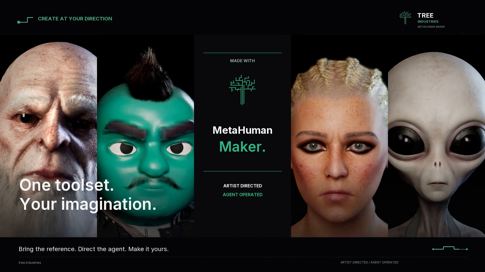
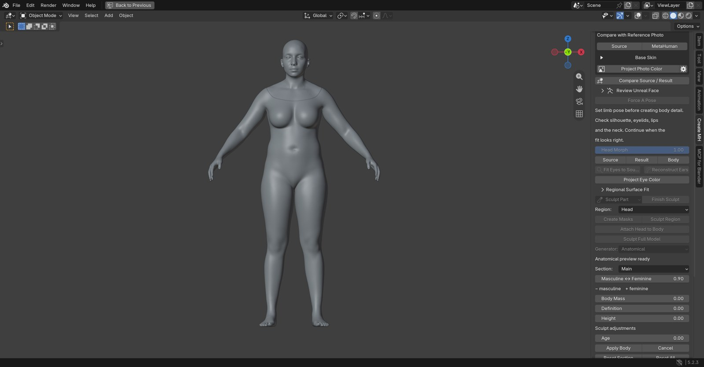
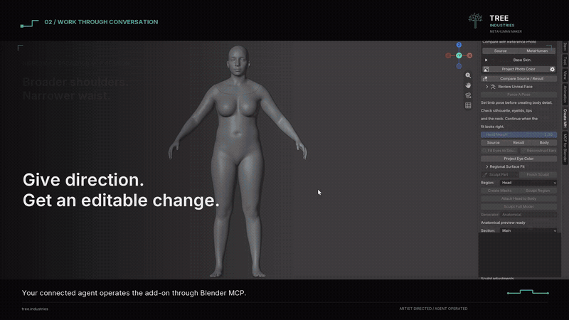
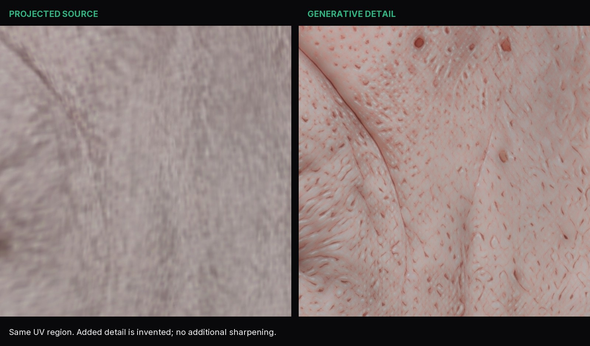
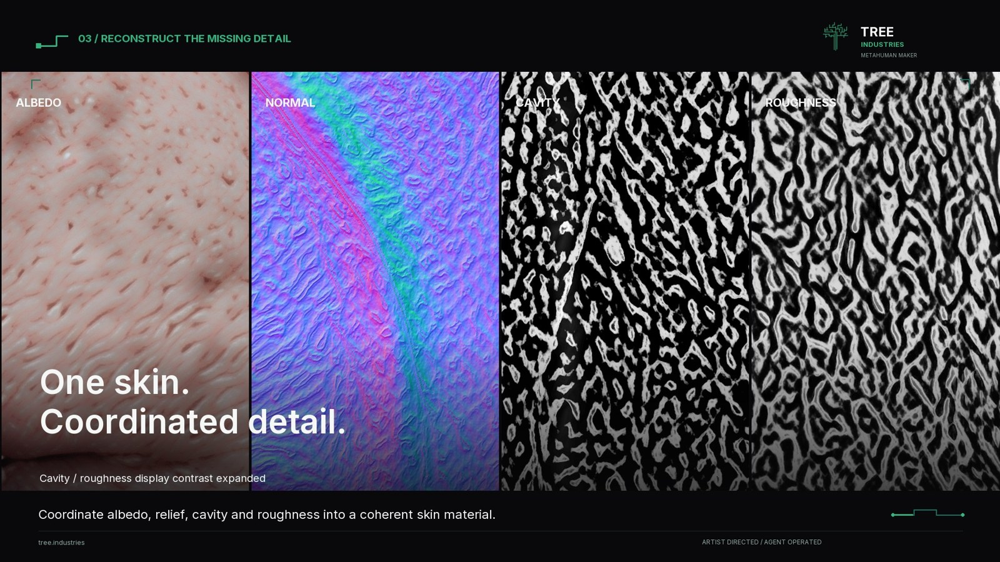
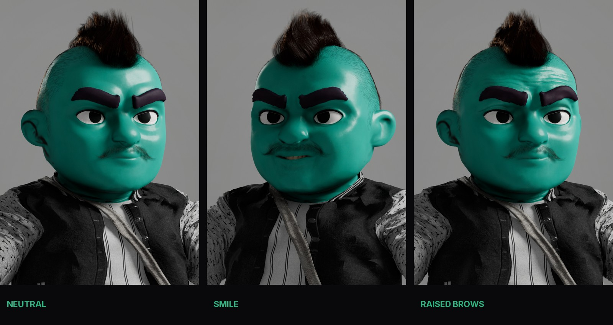

<p align="center"></p>

# MetaHuman Maker

**Character creation for artists and AI agents.**

A Blender add-on from [TREE Industries](https://tree.industries/) for turning photos and source meshes into editable MetaHuman characters. Fit and shape the character, repair difficult regions, reconstruct missing skin detail, and carry your work into Unreal Engine. Work through the guided interface or let a connected AI agent operate the same tools through Blender MCP.

[](LICENSE)
[](docs/release-notes.md)
[](docs/installation.md)
[](docs/installation.md)
[](docs/installation.md)

[Get started](docs/quickstart.md) · [Install](docs/installation.md) · [Agent guide](docs/agents.md) · [Troubleshooting](docs/troubleshooting.md) · [Contribute](CONTRIBUTING.md)

[Download v0.346.0](https://github.com/TREE-Ind/MetahumanMaker/releases/tag/v0.346.0) · [Watch the launch film](https://github.com/TREE-Ind/MetahumanMaker/releases/download/v0.346.0/TREE_Industries_MetaHuman_Maker_Launch_Four_Characters.mp4) · [Film details](docs/launch.md)

[](https://github.com/TREE-Ind/MetahumanMaker/releases/download/v0.346.0/TREE_Industries_MetaHuman_Maker_Launch_Four_Characters.mp4)

The `main` and `development` branches contain source updates beyond the packaged v0.346.0 preview. Build from source to use those updates, and rebuild the bridge when native code changes. Photo fitting creates an editable starting identity; accurate likeness and hair require further authoring.

## Bring the reference. Keep creative control.

- **Start from a mesh or photo.** Wrap a scan, sculpt or generated mesh to your licensed MetaHuman reference topology, or fit a starting face from a photo. Add up to four supporting views for optional shape refinement and texture coverage, with projection up to 4K. Generated side views infer unseen features.
- **Shape an editable character.** Refine head and body proportions, use anatomical body controls, work with sculpt layers, and repair regions without replacing the whole character.
- **Let an agent do the tool work.** Inspect scene state, invoke Blender operators, adjust the result, and observe background jobs through a trusted Python bridge.
- **Create the detail the source is missing.** Combine source-guided cleanup, optional learned restoration and generative editing with an explicit texture invention budget and protection masks.
- **Build a coherent skin material.** Project source detail onto subdivided sculpt layers, bake normal/cavity maps, and coordinate color, roughness and inferred relief at resolutions up to 8K.
- **Keep authoring across applications.** Exchange grooms, deliver native MetaHuman characters, request rigs and texture sources, assemble in Unreal, and preserve supported artist appearance edits.

The original code is open source under MIT, including commercial use. MetaHuman content, third-party models and input assets retain their own terms. [License details](THIRD_PARTY_NOTICES.md).

## A workflow you can direct

| Stage | What you do |
| --- | --- |
| **1. Start** | Choose a project folder, reference library and source mesh, or fit a starting face from a photo. |
| **2. Wrap** | Review alignment and landmarks, fit the head/body, and inspect the silhouette. |
| **3. Refine** | Adjust proportions, sculpt or repair regions, and review eyes, lids, lips and the neck. |
| **4. Texture** | Project source color/detail, repair trouble spots, reconstruct skin and bake the material maps. |
| **5. Hair** | Author or transfer grooms and prepare native exchange. |
| **6. Export** | Save the Blender project, deliver to Creator and review the native result before assembly. |



Follow the [first-character walkthrough](docs/quickstart.md), then use the [workflow guide](docs/workflows.md) for photo fitting, body shaping, texture repair, grooms and delivery.

## Agent-native, with an artist in control

The add-on exposes Blender operators and inspectable project/job state. A connected agent can make an edit, inspect the updated mesh, revise it, and check delivery readiness. The same project stays available to the artist in Blender.



The clip shows a real recorded MCP session, condensed for readability; the local project path is redacted. The add-on supplies the character tools; bring your own agent and trusted Blender MCP/Python connection. An LLM or chat service is not bundled.

```python
import bpy

# Run inside Blender, after configuring the reference library and worker.
# Set source_path to the absolute path of your source mesh.
bpy.ops.cm.import_mesh(
    filepath=source_path,
    role='source',
    prepare_workflow=True,
    wrap_mode='FULL_BODY',
    placement='AUTO',
)
```

See the [agent integration guide](docs/agents.md) for inspect/edit/poll/apply examples, job recovery and review boundaries.

## Source-guided skin reconstruction

Preserve an accepted projection, protect important paint, and choose how much new detail is allowed. Use fast restoration or optional diffusion/reference-editing backends, then coordinate the resulting color and material detail. Learned backends are opt-in and run with separately provisioned models.



*Actual matched UV crop: projected source on the left, generated detail on the right. Added detail is invented; it is not recovered ground truth.*



*Cavity and roughness display contrast is expanded for this breakdown. The repository contains demonstration images, not character texture atlases.*

Read the [skin workflow](docs/workflows.md#skin-projection-repair-and-reconstruction) for invention controls, protection masks, map derivation and 8K resource considerations.

## From stylized source to editable character



The Genie, Orc, alien and photo study exercise different parts of the toolset. Results still need an artist's eye, especially on unusual anatomy and eye/lid motion. These images show actual local results; licensed templates, character projects and model weights are not bundled.

## Install and try it

The launch target is **Windows x64, Blender 5.2.x and Unreal Engine 5.8.x**; local workflows were exercised on Blender **5.2.3** and UE **5.8.2**. The bridge is **0.29.0**. Other platforms and versions need separate validation.

| Download / component | Purpose |
| --- | --- |
| [`metahuman_maker-0.346.0.zip`](https://github.com/TREE-Ind/MetahumanMaker/releases/download/v0.346.0/metahuman_maker-0.346.0.zip) | Installable Blender add-on, including the Windows groom helper. |
| [`MetaHumanMakerBridge-UE5.8-0.29.0.zip`](https://github.com/TREE-Ind/MetahumanMaker/releases/download/v0.346.0/MetaHumanMakerBridge-UE5.8-0.29.0.zip) | Compiled Windows editor bridge for the tested Unreal installation. |
| Source archive / Git checkout | Development and rebuilding; not a Blender installer. |

1. Install the Blender ZIP through **Preferences → Add-ons → Install from Disk**, enable **MetaHuman Maker**, then open **N → MetaHuman Maker** in the 3D View.
2. Prepare the separate numerical worker and your own licensed reference library.
3. For native exchange, install the bridge into your UE project's `Plugins` folder, enable Python remote execution and the MetaHuman plugins, and install Creator Core Data.
4. Start with the procedural demo or a modest source mesh; complete one wrap/refine/texture/delivery pass before adding optional models.

The [installation guide](docs/installation.md) separates packaged setup from source builds. The [quick start](docs/quickstart.md) walks through the first character.

## Documentation

| Guide | Use it for |
| --- | --- |
| [Installation](docs/installation.md) | Requirements, installers, worker setup, reference library and Unreal configuration. |
| [Quick start](docs/quickstart.md) | Your first character from import to native review. |
| [Artist workflows](docs/workflows.md) | Photo input, mesh fitting, body shaping, skin, grooms and exports. |
| [Agents and automation](docs/agents.md) | Blender MCP, operators, asynchronous jobs and editable handoff. |
| [Troubleshooting](docs/troubleshooting.md) | Setup failures, resource limits, stale maps and recovery. |
| [Known limitations](docs/known-issues.md) | Current support scope and areas that still require review. |
| [Development](docs/development.md) | Architecture, local checks, packaging and contribution workflow. |
| [Release notes](docs/release-notes.md) | What's in the public preview and the latest changes. |

## Project status

This is an actively developed **source preview**. Core workflows have been exercised locally; this release does not certify every character, expression, LOD or material combination. Photo fitting is a starting point, extreme stylization can need regional correction, and eye/lid calibration remains experimental. See [known limitations](docs/known-issues.md) for practical boundaries.

Portable web exports and native web bundles are also available. Browser skin, grooms and sampled facial controls approximate native rendering; see [export scope](docs/workflows.md#web-and-threejs).

## Contribute

Useful contributions include reproducible bugs, smaller setup steps, documentation, platform validation, and solver or material improvements backed by before/after evidence. Start with [CONTRIBUTING.md](CONTRIBUTING.md) and the [development guide](docs/development.md). For sensitive reports, use [SECURITY.md](SECURITY.md).

## License and attribution

Original project code and documentation are [MIT licensed](LICENSE). Third-party dependencies and separately obtained assets retain their own licenses; see [THIRD_PARTY_NOTICES.md](THIRD_PARTY_NOTICES.md). This is an independent project and is not an official Epic Games product.

Built by [TREE Industries](https://tree.industries/) and contributors.
