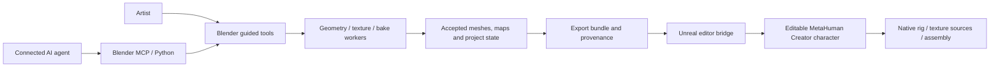

# Development

[Contributing](../CONTRIBUTING.md) · [Agent interfaces](agents.md) · [Release checklist](releasing.md)

## Architecture



| Location | Responsibility |
| --- | --- |
| `create_metahuman/` | Blender UI/operators, geometry/material work, workers and native exchange scripts. |
| `plugins/CreateMetaHumanBridge/Source/` | Editor-only Unreal C++ integration; built against the user's engine. |
| `tools/` | Public packaging, source audit, optional dependency/model provisioning and native helper builds. |
| `release/models/` | Pinned download plans, not model weights. |
| `tests/` | Public offline packaging and selected orchestration checks. |
| `docs/` | User/developer guides and small real-workflow documentation images. |

Start with [guided.py](../create_metahuman/guided.py), [map_provenance.py](../create_metahuman/map_provenance.py), [unreal_jobs.py](../create_metahuman/unreal_jobs.py) and [unreal_import.py](../create_metahuman/unreal_import.py).

## Local setup

Use Python 3.12 for repository tools. Blender and Unreal own their embedded runtimes; numerical/learned workers use separate environments. See [source build instructions](installation.md#build-from-source).

The repository deliberately excludes development character projects, engine installations, reference DNA, texture atlases, model weights and local environments. Use your own licensed data. Keep generated material/mesh fixtures out of Git unless they are small and redistributable.

## Checks that run without Blender or Unreal

```powershell
python tests/release_source.py
python tests/native_assembly_memory.py
python tools/source_release.py
```

These standard-library checks audit the public source boundary, documentation links, image signatures, deterministic source staging/archives and selected native resource-budget contracts. They do not certify visual quality or execute Epic services. CI runs them on Windows and Linux.

For a geometry/material/runtime change, include one meaningful complete workflow with before/after evidence and versions. Preserve unrelated regions, accepted paint, cancellation/recovery and map provenance. Avoid repetitive test scenes that only restate an implementation.

The multi-view geometry regression needs NumPy and SciPy but no licensed model weights: `python tests/photo_multiview.py`. It checks a known depth change that a frontal view cannot resolve, with camera-only baselines, frontal protection and unchanged non-head identity parameters. Native character appearance still needs a complete Blender/Unreal review.

## Package the add-on

After the groom helper is built:

```powershell
python tools/build.py --addon-only
python tools/verify_package.py dist/metahuman_maker-0.346.0.zip
```

Source and package inventories must match; dependency notices are included. The Unreal bridge has its own version and engine-specific build. Rebuild it when changing native code or targeting a different engine build.

## Prepare a clean public source tree

```powershell
python tools/source_release.py --archive --stage build/github-ready-metahuman-maker-0.346.0
```

Use a fresh destination. The tool selects an explicit public inventory, audits included text and documentation media, writes SHA256 identities, and verifies the staged tree. It does not follow linked directories or inspect excluded credential files. The source archive omits binaries; release installers are separate assets.

The public repository is [TREE-Ind/MetahumanMaker](https://github.com/TREE-Ind/MetahumanMaker). Clone it for development and create a feature branch from `development`. The release inventory and `.gitignore` keep local environments, generated assets and credentials out of commits. In an existing production workspace, stage only public source and run the inventory audit before pushing. Never force-add ignored assets. See [releasing](releasing.md) for the final checklist.
