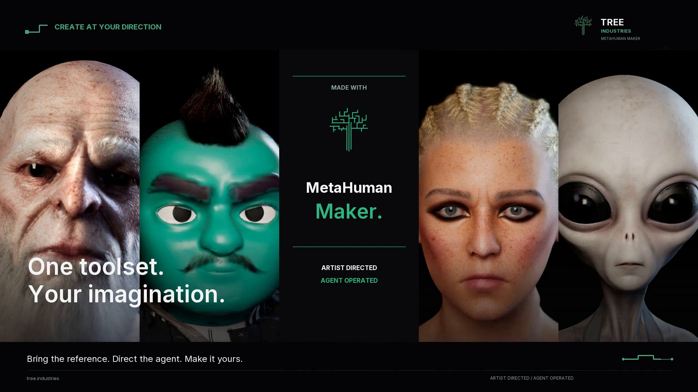

# Launch film

[Back to README](../README.md)

The current [launch film](https://github.com/TREE-Ind/MetahumanMaker/releases/download/v0.346.0/TREE_Industries_MetaHuman_Maker_Launch_Four_Characters.mp4) is a 69.5-second, 1080p cut featuring the Orc, outfitted Genie, Warrior and gray Alien. It shows textured source-mesh comparison, recorded agent inspection, source-guided generative skin, invention control, and editable native character results.

The closing scene retains the four character light rotations with TREE Industries branding and the GitHub link. This launch cast focuses on source-mesh workflows. Photo fitting provides an editable starting identity and requires further authoring; see [known issues](known-issues.md).

The current cut uses the project owner's commercially licensed **Soft Gravity** track. Older archived launch films have their own music credits; retain those credits when redistributing an archived film.

The film is hosted as a release asset and stays out of ordinary source history. See the [agent guide](agents.md) and [workflow guide](workflows.md) for the tools shown.
