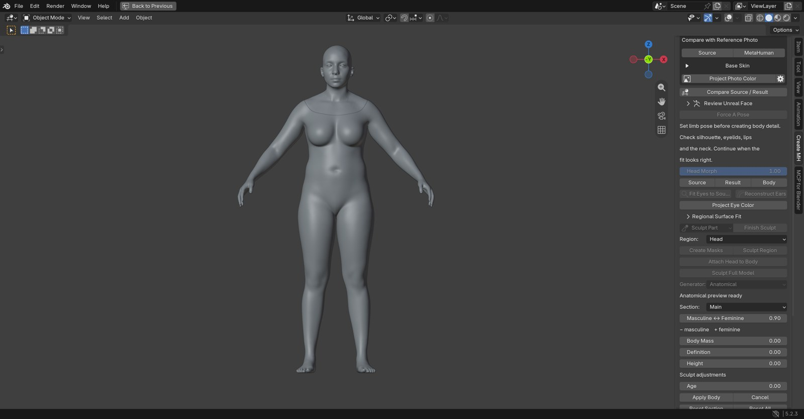
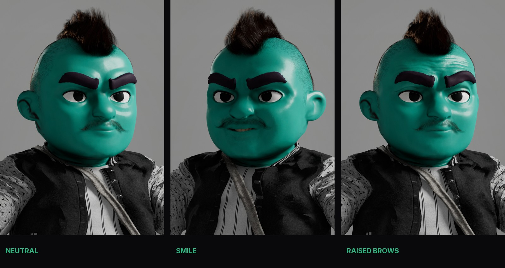

# Your first character

[Install first](installation.md) · [Artist workflows](workflows.md) · [Agent guide](agents.md)

The goal of this walkthrough is one saved character project and a native result you have inspected. Begin with a modest source and 2K/4K maps; add dense detail and 8K reconstruction after the basic path works.

## 1. Start a project

Open **N → MetaHuman Maker**, choose a project folder and character name, and select your prepared **Reference Library**. Choose head or full-body work as appropriate. Import a source mesh with its materials, or use the [photo workflow](workflows.md#photo-to-starting-face).

Use **Create Demo** if you want to learn the panel before bringing in licensed references. The demo is a procedural learning fixture, not a native MetaHuman template.

## 2. Align and wrap

Review scale, facing direction, limb pose and landmark pairs. Run the guided wrap, then compare source and result before accepting the fit. For a dense source, use **Large Source / Solver Proxy**: the proxy drives fitting while the original remains available for textures and detail projection.

Always inspect **front, profile and back**. Pay particular attention to the eye sockets, ear attachments, mouth, neck, hands and feet. A good front silhouette alone is not acceptance.

## 3. Refine the character

Adjust the body and repair regions through the add-on. Apply a body pass to keep it, or cancel to restore the preceding accepted shape. In Anatomical mode, wait for **Anatomical preview ready** before **Apply Body**.

**Masculine ↔ Feminine** is an absolute native trait position: negative is masculine, positive is feminine. A fresh pass loads the saved native position. Measurement controls are relative adjustments.

Review the neck and surrounding parts after a regional change. Save with the add-on rather than depending only on an unsaved viewport preview.

## 4. Project and repair skin

Transfer source color and inspect it before deriving other maps. Use Smart Paint for localized repairs, preserving important marks with protection masks. Apply or cancel the paint session explicitly.

When the projection is clean, optionally run [skin reconstruction](workflows.md#skin-projection-repair-and-reconstruction). Set **Texture Invention** conservatively for source fidelity, or allow more new detail when the character design permits it. Protect accepted paint; inspect seams, nostrils, eyelids, lips and ears.

Bake/review normal, cavity and roughness along with albedo. Keep projected sculpt detail distinct from art-directed relief inferred from color. Recheck map freshness after changing geometry or UVs.

## 5. Save and deliver

Save the project through the add-on, resolve the delivery checks, and **Push** to a fresh native character destination. Keep the original project and its action receipts. In Unreal, confirm the character, materials and accessories before requesting the full rig or texture sources.

The add-on exposes **Request Full Rig**, **Download Texture Sources** and assembly actions for the linked character. Rigging/source requests use Epic's services and need your configured account/content access. Wait for the original request's receipt instead of submitting again after a timeout.

## 6. Review the native result

Check the native character from front, profile and back, then use a few representative expressions and gaze states. Review eyes, lids, lips, ears, the neck, grooms and the dressed silhouette. Extreme expressions and lower LODs need their own review before treating the result as final.

Keep refining the editable character in MetaHuman Creator. Use supported texture/appearance update paths to preserve artist changes; geometry edits after delivery require a matching new character revision. See [Unreal delivery](workflows.md#unreal-delivery-and-artist-edits).

If something stops, use [troubleshooting](troubleshooting.md). Reopening a saved project should resume observation of existing jobs and receipts, not launch duplicate native requests.
