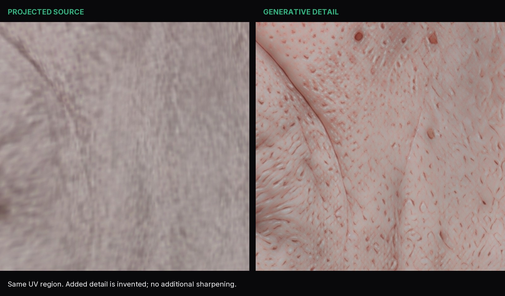
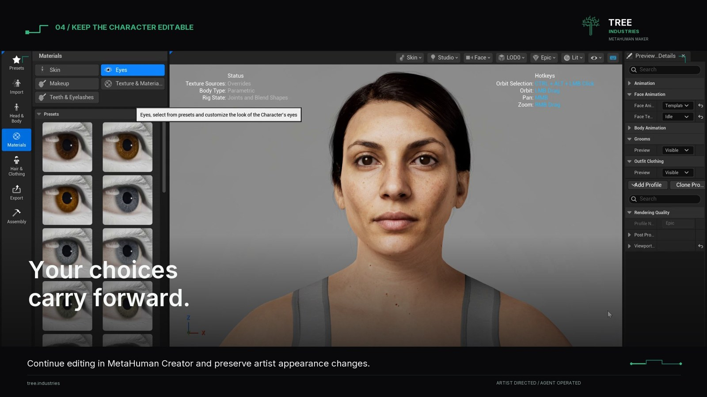

# Artist workflows

[README](../README.md) · [Quick start](quickstart.md) · [Known limitations](known-issues.md)

## Mesh to MetaHuman

Import the source into the guided workflow with a matching licensed reference library. Align scale, facing and limb pose, inspect landmarks, then wrap. Refine the fit regionally and retain the source for comparison. Dense sources can use a generated solver proxy; texture/detail projection continues to use the original source. Rebuild the proxy after editing source geometry.

Canonical template topology, UVs and semantic identities must survive native conform. Fitting arbitrary source topology does not make an arbitrary template a valid MetaHuman template. Inspect front/profile/back and difficult anatomy before moving to textures.

## Photo to starting face

In Start, use **Generate Face → Fit Starting Face from Photo** with a clear near-frontal, neutral photo and a closed mouth. The fit runs in a cancellable background process. Choose **Create Fitted Source**, compare it with the reference, then use the ordinary wrap workflow.

Source and MetaHuman comparison modes share a camera/opacity control. Project photo color when the face is aligned, and inspect the result in 3D. A single photograph does not supply complete head/body geometry or invisible-side texture; this is an editable starting point, not a guaranteed likeness reconstruction.

GNM generation is another optional starting point. It uses separately provisioned identity models/decoders and still needs wrapping onto your licensed reference before native delivery.

## Body shaping

**Regional** provides independent sculpt-style controls. **Anatomical** uses the installed native body model through an isolated Unreal worker; its secondary sculpt adjustments remain separately labeled.

Start a pass, adjust controls, review the live result and apply or cancel. Anatomical **Masculine ↔ Feminine** is an absolute normalized native trait position; girth/measurement controls remain relative to the pass baseline. Applying retains the native state for later passes. Cancel returns to the preceding accepted head/body and companion parts.

Review shoulders, the neck seam, upper arms, hips, knees, hands and feet from several views. Do not use a successful body pass as a substitute for inspecting a strongly stylized source.

## Sculpt detail and baking

Use retained sculpt layers and source-detail projection to carry geometric detail onto a subdivided surface. Bake final normal/cavity maps at the chosen resolution, up to 8K where supported. Dense subdivision and high-resolution maps can consume substantial memory; use the resource estimates before starting.

Retained head and wrinkle layers can follow accepted identity changes through cancellable updates. Finish pending sculpt returns before delivery. Map provenance checks associate outputs with geometry, UVs and bake inputs; changed inputs can make maps stale.

## Skin projection, repair and reconstruction

1. Transfer the source albedo and keep a preserved projection for comparison.
2. Repair local problems with **Smart Paint**. Choose the skin part and matching-UV reference, inspect each region, then **Apply Paint** or **Cancel**. Session Undo/Redo affects the paint session; it is not permission to overwrite original source images.
3. In the skin solver, choose **Detail Prior**: **Fast Restoration**, **Diffusion Super Resolution**, or **Reference Editing**, with their separately configured runtimes/models.
4. Set **Texture Invention**. Zero retains the chosen input; larger values allow stronger bounded local replacement. Broad color, UV boundaries and protected paint remain constrained by the selected workflow. This is a permission control, not a promise of unchanged pixels everywhere.
5. For reference editing, use **Skin Detail Brief**, **Preserve Source Structure** and explicit protection/repair masks. **Continuous Surface** operates on physical skin patches; **UV Patches** works on overlapping atlas crops.
6. Choose the output resolution. The current 8K learned path accepts 2K/4K inputs or an existing 8K atlas for PiSA-SR; reference surface editing requires a 4K input. Confirm the configured backend's constraints before running it.
7. Compare the output to the source, inspect seams and repair areas, then coordinate the material maps.

For a broad generative redesign, provide one coherent, UV-matched face atlas to **Generated Albedo**. Preserve the original island layout and facial feature positions, mask protected regions, and inspect the registered atlas before deriving surface maps. Local surface editing adds bounded material detail; it does not give each patch permission to invent another face. The invention budget controls artistic freedom within that spatial constraint.



**Inferred Relief**, **Derive Skin Material** and **Move Shading into Surface Maps** are art-direction tools. Color-driven relief/material contributions are not measured physical depth or reflectance. Keep accepted sculpt normals where appropriate, and use explicit masks for damaged normal/AO regions. Repaired albedo alone does not automatically rebake all dependent maps.

The original source/projection and accepted artist paint remain important references. Inspect nostrils, inner eyelids, lips, ear attachments and UV seams at the final scale. Prefer modest invention where identifying marks matter.

## Wrinkles and expression maps

Author/sculpt the three native wrinkle slots, then bake the desired WM1/WM2/WM3 normal and CM1/CM2/CM3 expression-color maps. Their resolution is separate from the final normal/cavity setting. Inspect each map and its neutral basis.

For an unchanged delivered shape, **Update Unreal Textures** can add newly baked maps without another conform or rig request. Geometry must still match the original delivery. A conflicting artist reassignment of a managed animated-map slot stops the update for review. Existing assembled copies need reassembly to receive updated Creator textures.

## Expression and eye review

Use **Expression Check** with a prepared matching native reference to preview poses locally, and return to neutral before export. Complete active paint/sculpt sessions first. Local previews do not certify the assembled rig.

**Review Unreal Face** can connect to a selected assembled character. The native control mixer exposes readable/raw controls, region filters and paired L/R controls. Use representative strengths and gaze combinations; full eye/lid calibration and corrective staging remain experimental. See [known limitations](known-issues.md).

## Grooms

Author or transfer groom strands in the Hair step, inspect the scalp fit and choose **Export Unreal Alembic** when appropriate. The Windows helper emits static strands, groups, widths, guide flags and scalp root UVs. Unreal import uses the Alembic Groom Importer, with final materials and a compatible skeletal binding.

Static strand exchange does not create simulation or animation caches. Native stock wardrobe grooms and artist-authored custom grooms have different binding/material requirements. Inspect the finished head with the actual groom before delivery.

## Unreal delivery and artist edits

Push a saved project to a fresh Creator character destination, complete the requested native rig/source operations, then assemble to a fresh output. Use the linked character and durable receipts to observe work. Material-baking assembly needs rendering enabled; a NullRHI worker is not a material-baking editor.

Native appearance capture and selective transfer preserve supported artist changes, including package/property state. These paths are broader than copying just the Blender albedo. Custom shaders, external dependencies and unsupported edits still need review; there is no universal lossless round-trip promise.



Geometry changes require a matching new delivery before texture updates or rig evaluation. Complete shape changes before requesting the final rig. Confirm native head/body shape, materials, eyes, grooms and selected assembly profile on the actual result.

## Web and Three.js

**Export Static GLB** produces accepted textured geometry with available eyes/teeth and portable PBR material approximations. It does not include a native skeletal rig, DNA or strand grooms.

The separate **native web bundle** path captures rigged character resources, sampled face controls, supported skin/eye appearance and grooms for browser use. It is a different workflow from static GLB. Browser materials, groom rendering and sampled nonlinear facial combinations approximate the native character. Review your actual bundle in the target browser; parity with every native shader and artist modification is not guaranteed.

### Character-only game asset

For engines that import standard glTF without the native web bundle's renderer hooks, convert a completed full-body native web bundle to one embedded GLB. Run this in a Python environment with NumPy, SciPy and Pillow:

```sh
python create_metahuman/portable_character.py --source ./Character-WebBundle --output ./Character.glb --report ./conversion.json
```

The GLB includes embedded PBR textures, the rig, sampled facial morphs and reduced skinned groom ribbons. Shared body/face joints replace Unreal's Copy Pose dependency. Four strongest influences are retained per vertex for stock loaders; the report measures discarded influence weights. Authoring vertex masks are excluded from visible color. No viewer, lighting studio, renderer library or character JavaScript is required.

Native skin shading and groom behavior become portable approximations. Animated material responses and RigLogic are omitted; facial morphs remain available by name. Retarget locomotion clips to the included skeleton: this conversion does not create idle, walk or run animations. Validate the GLB in the destination game engine before publishing it.
